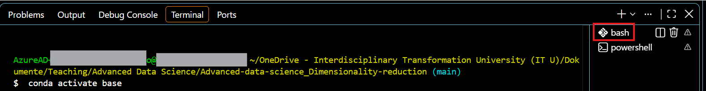

# Advanced data science: dimensionality reduction

Practical exercises for inspecting biomedical data using dimensionality reduction methods.

# Installing software

For this practical exercise, we will need the following software:

- VS Code
- Conda (miniconda)
- Chrome

[Install VS Code](https://code.visualstudio.com/docs/setup/windows) if your computer does not have it yet. If you are using the IT:U computers with Windows, choose the "Install User setup" and "Install with the Windows installer" options. If you are not using Windows, adapt installation of required software to your system.    

[Conda](https://www.anaconda.com/docs/getting-started/main) is a package and environment manager that is widely used in the biomedical field. It allows us to create self-contained environments with specifications of different software, including versions. Conda environments make it easier for us to install software and to do reproducible analysis. For the practical exercises in this course, we will use miniconda, a small, lightweight installer for conda environments. If you already have conda installed, skip this step. Otherwise, install miniconda following the steps mentioned in the [Anaconda website](https://www.anaconda.com/docs/getting-started/miniconda/install/windows-gui-install). **Important: in step 9, add Miniconda3 to your PATH environment variable!** This is important for VS Code to be able to find the installed conda.     

If you **do not** have [Chrome](https://www.google.com/chrome/) installed, install it using their specifications. We will use Chrome since it has the best compatibility with Jupyter Notebooks.   

# Running the notebook

For the next steps, use the ```bash``` option of VS Code, not ```powershell```! Select it on the right side of VS Code's terminal (as shown below).  



Clone this repository in your VS Code's terminal. 

```
git clone https://github.com/IT-U-Teaching/Advanced-data-science_Dimensionality-reduction
cd Advanced-data-science_Dimensionality-reduction
```

Create the environment in your computer based on the yaml file we created previously and install the required software (this step is **only required once**):

```
conda env create -f  env_ADS_DR.yaml
```

After installation, you can activate the environment and run the Jupyter Notebook on Chrome. Choose Chrome for opening the notebook, do not use the default browser, since it may not have the best compatibility with Jupyter.

```
conda activate env_ADS_DR
jupyter lab --browser=chrome
```

If Chrome does not open automatically after the you run the command, look in your VS Code terminal for a line that looks like ```http://localhost:8888/?token=....```. Copy and paste that entire URL into Chrome and select the notebook file.
